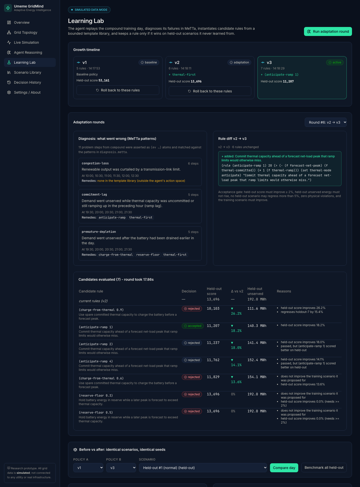
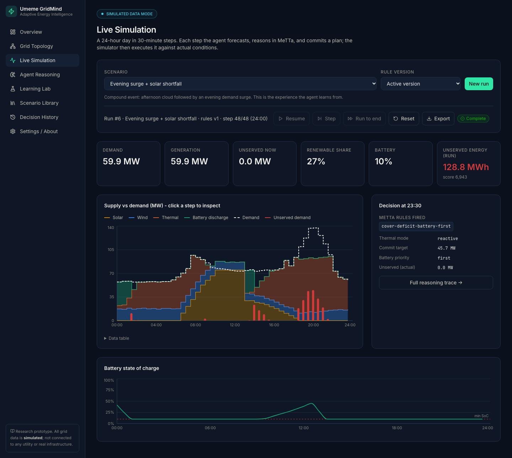
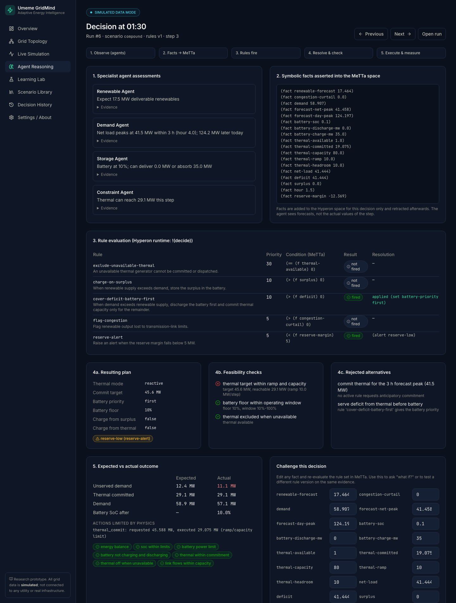
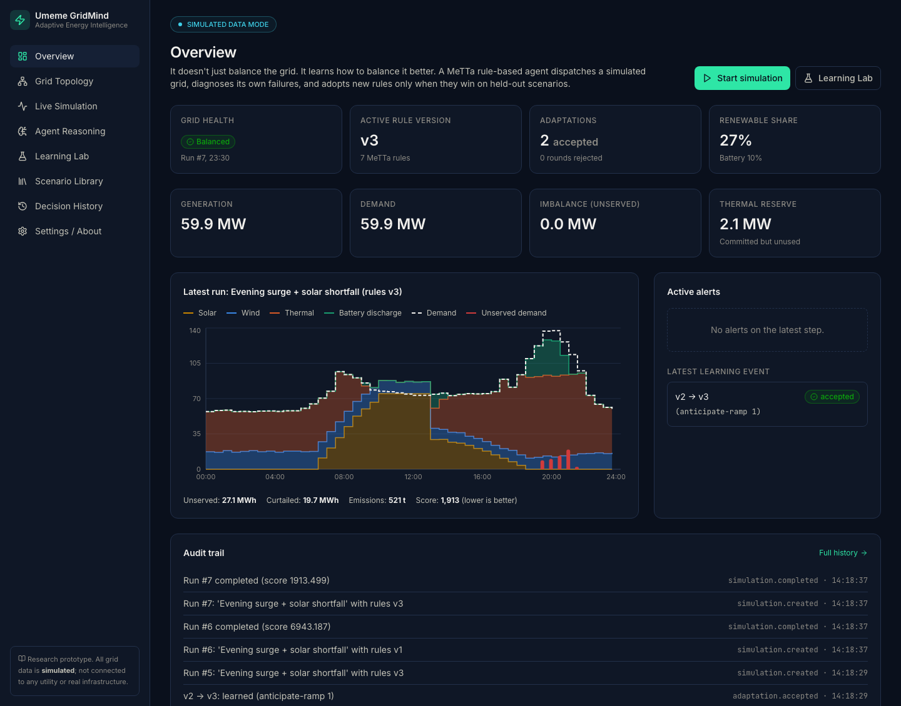
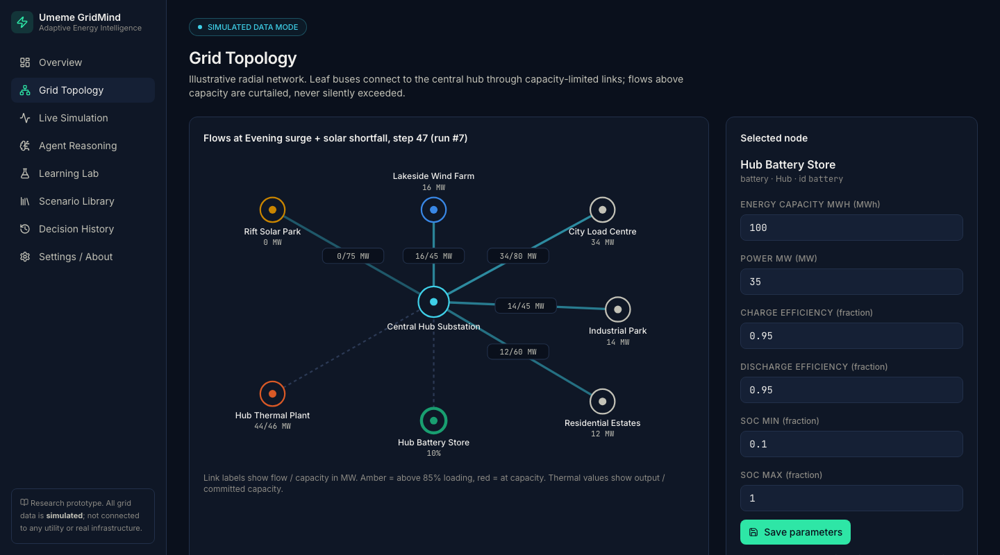

# Umeme GridMind

**Adaptive Energy Intelligence.** *It doesn't just balance the grid. It learns how to balance it better.*

Submission to the BASIX.MARKET State of the Art Hackathon (October 2026), MeTTa Foundation track, challenge **"The Agent That Grows Up"**.

> **Simulation only.** All grid data is synthetic and illustrative. This is an educational research prototype, not a certified grid controller. It is not connected to any utility, SCADA system or live grid.

## The problem

Grids with lots of solar and wind face fast swings in net load. A thermal plant can only ramp so fast, and a battery holds only so much energy. A fixed rule such as "use the battery first" works on an ordinary afternoon but fails badly when clouds and an evening demand surge arrive together: the battery is already empty when the peak hits, and the thermal plant cannot ramp in time.

## What Umeme GridMind does

1. **Starts small.** Five rules, written in MeTTa (`metta/rules/baseline.metta`).
2. **Reasons in MeTTa every step.** Four specialist agents (renewable, demand, storage, constraint) turn forecasts into symbolic facts. The Hyperon runtime evaluates the rules against those facts, and the coordinator resolves conflicts by priority, checks feasibility, and dispatches.
3. **Lives with the consequences.** A physics simulator executes the plan against *actual* conditions, enforces every limit, and measures unserved energy, curtailment, emissions and violations.
4. **Diagnoses itself in MeTTa.** Failure steps become `(ev …)` atoms and are matched against symbolic failure patterns (`commitment-lag`, `premature-depletion`, `congestion-loss`).
5. **Proposes and tests changes.** MeTTa maps patterns to remedy templates and instantiates candidate rules. Each candidate is simulated on the training day and on 8 held-out days with identical seeds.
6. **Grows only when it is better.** A rule is adopted only if it passes an explicit acceptance gate. Every version is stored, diffable and reversible, and every decision is in an inspectable ledger.

### Measured result ([docs/BENCHMARKS.md](docs/BENCHMARKS.md))

| Held-out (8 days, never used for learning) | v1 baseline | v2 (+`thermal-first`) | v3 (+`anticipate-ramp 1`) |
|---|---|---|---|
| Unserved energy (MWh) | 992.4 | 192.0 | **140.2** |
| Composite score (lower is better) | 53,161 | 13,696 | **11,207** |
| Emissions (tCO₂) | 3,155 | 3,613 | 3,714 |
| Constraint violations | 0 | 0 | 0 |

A third round rejects all four remaining candidates, so the agent plateaus. The gains cost emissions and curtailment, and a thermal outage remains unfixable. All of this is shown in the UI rather than hidden.

## How MeTTa is used (genuinely)

- **Policy rules are MeTTa atoms**: `(rule name priority condition directive "description")`.
- **Inference** runs in Hyperon: `!(decide)` in `metta/rules/core.metta` matches each rule and evaluates its condition against `(fact …)` atoms asserted for that step.
- **Diagnosis** runs in Hyperon: `!(diagnose)` over `(ev …)` atoms using `pattern` rules, and `(remedy pattern template)` lookups.
- **Rule generation** runs in Hyperon: templates with variables are instantiated with `(let $params <option> (quote $rule))`.
- Python only formats facts in, parses atoms out, and does the numeric physics. `GET /api/health/` probes the runtime, and the reasoning page shows the exact fact atoms and rule results for every step.

See [metta/README.md](metta/README.md) and [docs/ARCHITECTURE.md](docs/ARCHITECTURE.md).

## Features

- Deterministic, seeded 24-hour simulation (48 × 30-min steps): solar, wind, a ramp-limited thermal plant with spinning-reserve emissions, a battery, three loads, capacity-limited links.
- Scenario library: 7 predefined, 1 training (compound) and 8 generated held-out scenarios.
- Explainable decision ledger: agent evidence, MeTTa facts, fired and overridden rules, plan, feasibility checks, rejected alternatives, expected vs actual, invariant checks.
- "Challenge this decision": edit facts and re-run MeTTa with any rule version.
- Learning Lab: adaptation rounds, diagnosis, candidate table with reasons, rule diff, growth timeline, rollback, side-by-side and held-out benchmark comparisons.
- Editable grid parameters (validated), audit trail, demo reset, JSON export.

## Tech stack

React 18 + Vite + TypeScript + Tailwind + Recharts + lucide-react · Django 5.1 + Django REST Framework · MeTTa via `hyperon` 0.2.10 · PostgreSQL (Docker) or SQLite (local) · pytest, Vitest, ruff · Docker Compose · GitHub Actions.

## Run it

### Option A: Docker Compose (PostgreSQL)

```bash
cp .env.example .env    # then set DJANGO_SECRET_KEY and POSTGRES_PASSWORD
docker compose up --build
# UI:  http://localhost:8080   API: http://localhost:8000/api/health/
```

Migrations and seeding run automatically on backend start.

### Option B: Local development (SQLite)

Requires Python 3.10+ (3.11 tested) and Node 20+.

```bash
python3.11 -m venv .venv
.venv/bin/pip install -r backend/requirements-dev.txt

cd backend
export DJANGO_DEBUG=1
../.venv/bin/python manage.py migrate
../.venv/bin/python manage.py seed_gridmind
../.venv/bin/python manage.py runserver 127.0.0.1:8000

# second terminal
cd frontend
npm install
npm run dev        # http://localhost:5173 (proxies /api to :8000)
```

### Environment

See `.env.example`. Settings: `DJANGO_SECRET_KEY` (required unless `DJANGO_DEBUG=1`), `DJANGO_ALLOWED_HOSTS`, `CORS_ALLOWED_ORIGINS`, `DATABASE_URL` (defaults to SQLite), and the optional `GRIDMIND_WRITE_TOKEN`. If that token is set, POST/PATCH requests need an `X-GridMind-Token` header; enter it under Settings in the UI. `GRIDMIND_METTA_DIR` overrides the rules directory.

## Reproducible demo

1. Settings / About → **Reset demo** (or `python manage.py seed_gridmind --reset`).
2. Live Simulation → *Evening surge + solar shortfall*, rules v1 → *Run to end* (≈129 MWh unserved).
3. Learning Lab → **Run adaptation round** twice (v2 `thermal-first`, v3 `(anticipate-ramp 1)`), then a third (all rejected).
4. Learning Lab → compare v1 vs v3 → *Benchmark all held-out*.

The full timed script is in [docs/DEMO_SCRIPT.md](docs/DEMO_SCRIPT.md).

## Tests

```bash
cd backend && ../.venv/bin/python -m pytest -q   # 48 tests, ~90 s (includes full adaptation rounds)
cd backend && ../.venv/bin/ruff check .
cd frontend && npm test && npm run lint && npm run build
```

Backend tests cover physical constraints (SoC, power, ramp, outage, link capacity), energy balance on every step of every scenario × policy, determinism, MeTTa parsing, firing, fact retraction and template instantiation, diagnosis, priority resolution, the acceptance gate, the **held-out benchmark**, growth plateau, API validation, ledger, rollback, demo reset and write-token enforcement.

## API (selected)

| Method | Path | Purpose |
|---|---|---|
| GET | `/api/health/` | API + MeTTa runtime probe |
| GET | `/api/grid/` · PATCH `/api/grid/nodes/{id}/` · `/api/grid/links/{id}/` | Topology and parameters |
| GET | `/api/scenarios/` | Scenario library with roles |
| POST | `/api/simulations/` · `/{id}/step/` · `/{id}/reset/` | Run lifecycle |
| GET | `/api/simulations/{id}/` · `/{id}/metrics/` | Series and metrics |
| GET | `/api/decisions/?run=` · `/api/decisions/{id}/` | Decision ledger |
| POST | `/api/agent/reason/` | Evaluate facts against a rule version in MeTTa |
| GET | `/api/agent/rules/` · `/api/agent/rules/versions/` · `/versions/{v}/diff/` | Rules, versions, diffs |
| POST | `/api/agent/adapt/` · `/api/agent/rules/versions/{v}/rollback/` | Learn · roll back |
| POST | `/api/compare/` · `/api/evaluations/` | Policy comparisons |
| GET | `/api/audit/` · POST `/api/demo/reset/` | Audit trail · reset |

## Repository layout

```
backend/   gridmind/ (engine: grid, scenarios, simulator, reasoning, agents, runner, learning, benchmark)
           api/ (Django models, services, views)  config/  tests/
frontend/  src/ (pages, components, lib, types)
metta/     rules/ (core, baseline, templates, diagnosis)
docs/      ARCHITECTURE, BENCHMARKS, DEMO_SCRIPT, AI_DISCLOSURE, LIMITATIONS
```

## Screenshots

Captured from the running app (simulated data) after two adaptation rounds.

**Learning Lab.** The growth timeline v1 → v2 → v3, the MeTTa diagnosis of the training day, the rule diff adding `(anticipate-ramp 1)`, and every candidate with its held-out score and the reasons it was accepted or rejected.



**Live Simulation, baseline v1 on the compound day.** The battery drains overnight and again in the afternoon, so the evening surge goes unserved (red bars): 128.8 MWh lost.



**Agent Reasoning.** One baseline decision traced end to end: agent evidence, the fact atoms asserted into the Hyperon space, which MeTTa rules fired, the plan, the failed ramp feasibility check, rejected alternatives, and expected vs actual outcome.



**Overview.** The same day under v3: unserved energy falls to 27.1 MWh, at the cost of higher emissions.



**Grid Topology.** The radial network with live link flows and editable node parameters.



## Limitations

Simplified radial physics, a bounded template library, 8 held-out days, synchronous adaptation, and no user accounts. See [docs/LIMITATIONS.md](docs/LIMITATIONS.md).

## Team

| GitHub |
|---|
| [@Fleur41](https://github.com/Fleur41) |
| [@malise5](https://github.com/malise5) |
| [@matrixjnr](https://github.com/matrixjnr) |

## AI-use disclosure

Most of the code and documentation were written with Claude Code (Claude Opus 5.5). See [docs/AI_DISCLOSURE.md](docs/AI_DISCLOSURE.md); the team must complete the marked items.

## Credits and licences

Built on [Hyperon / MeTTa](https://github.com/trueagi-io/hyperon-experimental) (MIT), Django and Django REST Framework (BSD-3), React (MIT), Vite (MIT), Tailwind CSS (MIT), Recharts (MIT), lucide-react (ISC), PostgreSQL (PostgreSQL licence). Fonts: Inter and JetBrains Mono (SIL OFL, via Google Fonts). Project licence: [MIT](LICENSE).
