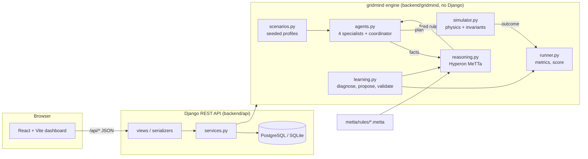
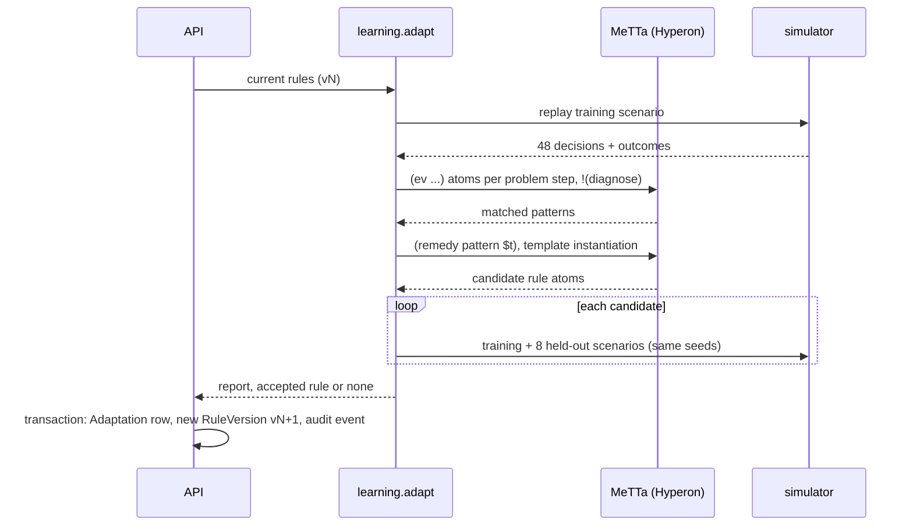

# Architecture

## Layers

| Layer | Location | Responsibility |
|---|---|---|
| MeTTa knowledge | `metta/rules/` | `core.metta` (rule evaluator), `baseline.metta` (v1 policy), `templates.metta` (bounded growth space), `diagnosis.metta` (failure patterns and remedies) |
| Reasoning | `backend/gridmind/reasoning.py` | Loads `.metta` files into Hyperon spaces, asserts and retracts facts, runs `!(decide)` and `!(diagnose)`, instantiates templates, parses result atoms |
| Agents | `backend/gridmind/agents.py` | Renewable, demand, storage and constraint agents produce facts and evidence from forecasts. The coordinator calls MeTTa, resolves conflicts by priority, builds the plan, and runs feasibility checks |
| Simulation | `backend/gridmind/simulator.py` | Executes a plan against actual conditions, enforces every physical limit, records clipped actions and invariant checks |
| Learning | `backend/gridmind/learning.py` | Experience → MeTTa diagnosis → candidates → held-out evaluation → acceptance gate |
| API | `backend/api/` | Models (decision ledger, rule versions, adaptations, evaluations, audit), REST endpoints, transactions |
| UI | `frontend/src/` | Pages for overview, topology, live simulation, reasoning trace, learning lab, scenarios, history |

The engine is plain Python and is tested independently of Django (`tests/test_simulator.py`, `test_reasoning.py`, `test_learning.py`).

## One decision step

1. **Observe.** Each specialist reads *forecasts* for the step (actual values times seeded noise) and returns facts plus evidence. Examples: `forecast-net-peak` (3 h), `forecast-day-peak`, `battery-soc`, `thermal-committed`, `reserve-margin`.
2. **Assert.** The coordinator adds `(fact <name> <value>)` atoms to the policy's MeTTa space.
3. **Infer.** `!(decide)` matches every `(rule name prio cond directive desc)` atom and evaluates `cond` against the facts in Hyperon, returning `(fired …)` or `(not-fired …)`. Facts are then retracted.
4. **Resolve.** For each setting (`battery-priority`, `thermal-mode`, `battery-floor`, …), the highest-priority fired rule wins. Lower-priority conflicting rules are recorded as *overridden*. Alerts are collected.
5. **Plan and check.** Settings become numeric set-points: a thermal commitment target with a 10% operating reserve, dispatch priority, battery floor, and charging permissions. Feasibility checks (ramp, SoC window, availability) and rejected alternatives are recorded, along with the expected outcome.
6. **Execute.** The simulator applies the plan to *actual* conditions. Thermal commitment rises at most 10 MW per step, the battery respects power and energy limits (emergency discharge down to the hard minimum before shedding load), and links curtail rather than overload. Every step checks seven invariants.
7. **Record.** The API stores the whole trace (facts, fired rules, resolution, plan, feasibility, alternatives, expected vs actual, state before and after) as one `Decision` row.

## Adaptation (one round)

Rollback creates a *new* version that copies an earlier rule set (like `git revert`), so history is never rewritten.

## Data model (Django)

`GridNode`, `GridLink`, `Scenario` (role: predefined, training or holdout), `RuleVersion` (rules JSON with exact MeTTa source, parent, origin, active flag), `SimulationRun` (state JSON), `Decision` (full trace per step), `Adaptation` (full report), `Evaluation`, `AuditEvent`.

## Units and modelling assumptions

- Power in MW, energy in MWh, 30-minute steps (48 per day). MWh = MW × 0.5.
- Radial network: a link's flow equals the net injection of its leaf bus. No AC power flow and no losses.
- Thermal plant: 80 MW. *Committed* (online) capacity can rise by at most 10 MW per step and can drop instantly; output can be anywhere from 0 to committed. Emissions are 0.45 t/MWh of output plus 0.06 t per MW-hour committed (spinning reserve).
- Battery: 100 MWh, 35 MW, 95% one-way efficiency, SoC window 10–100%.
- Solar 90 MW (link 75 MW), wind 40 MW (link 45 MW), three loads with morning and evening peaks.
- All values are illustrative and do not describe any real network.
